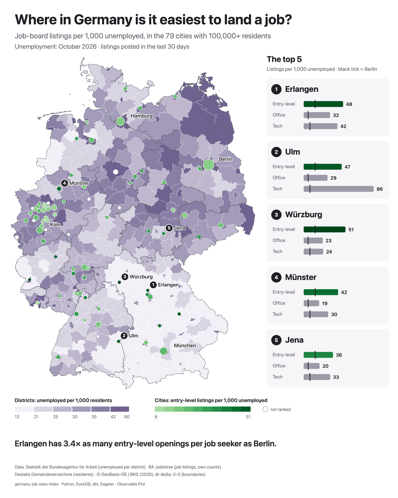

# germany-job-ease-index

**Where in Germany is it easiest to land a job, by type of work?** This project answers from the job seeker's side, using public data only: job-board listings per 1,000 unemployed people, for the 79 German cities with 100,000+ residents.



## Results (first snapshot, November 2026)

| Rank | City |
|---|---|
| 1 | Erlangen |
| 2 | Ulm |
| 3 | Würzburg |
| 4 | Münster |
| 5 | Jena |

Erlangen has **3.4×** as many entry-level listings per job seeker as Berlin (48 vs 14 per 1,000 unemployed). These numbers come from one day of job-board data. Daily snapshots are running, so lifetimes and trends will follow.

The full table is in [`data/exports/city_ease.csv`](data/exports/city_ease.csv), and the run's metadata is in [`summary.json`](data/exports/summary.json).

## Method

- **Listings:** for each city, the number of open listings on the [BA Jobbörse](https://www.arbeitsagentur.de/jobsuche/) posted in the last 30 days, with no radius. They are counted for a fixed set of search terms per kind of work ([`dbt/seeds/tier_terms.csv`](dbt/seeds/tier_terms.csv)):
  - **Tech:** DevOps, Cloud, IT-Support, …
  - **Office & support:** Kundenservice, Sachbearbeiter, …
  - **Entry-level:** Lagerhelfer, Verkäufer, Küchenhilfe, …
- **Job seekers:** the number of registered unemployed in the city's district (Kreis), from the Bundesagentur für Arbeit's monthly district statistics (October 2026).
- **Rate:** listings ÷ unemployed × 1,000, worked out for each kind of work.
- **Ranking:** cities are ranked for each kind of work, and the three ranks are averaged with **entry-level counting double** ([`dbt/seeds/tiers.csv`](dbt/seeds/tiers.csv)).
- **Not ranked:** 10 cities that make up less than half of their district's population, such as Hannover in the Region Hannover. The district's unemployment count mostly describes other places, so it would give them a misleading rate. They're listed with the reason in `summary.json`, so 69 cities are ranked.
- **History:** unemployment for all ~400 districts, monthly, from January 2007 to October 2026. Every gap is explained by a district reform (for example Hanau became a district-free city in 2026, and Eisenach merged into Wartburgkreis in 2021), recorded in [`dbt/seeds/district_changes.csv`](dbt/seeds/district_changes.csv) with sources.

Every bug found during development has a dbt test that keeps it fixed, for example AGS join integrity, a plausible unemployed-to-population ratio and districts matching the boundary file.

### Limitations

- A listing count measures openings, not hires. One employer can post many listings, and agencies repost.
- Search terms are a sample of each kind of work, not a full occupational classification.
- Unemployment is counted where people live, but listings are counted where the job is, so commuter cities (Erlangen is one) look better than their surroundings.
- Pay and access without a car are not in the index yet (planned).

## Privacy

Only aggregates are published. Listing-level data (titles, employers, reference numbers) stays in a local DuckDB warehouse and is never committed: see `.gitignore`. The published notebooks and map can only read marts on an allow-list (`src/jobease/showcase.py`), and a test enforces this.

## Stack

Python · DuckDB · dbt (dbt-duckdb) · Dagster · marimo · Observable Plot and D3. Everything runs locally; there's no cloud.

```
sources (BA, Destatis, BKG)  →  Python parsers  →  DuckDB landing tables
  →  dbt staging → intermediate → marts (with data tests)
  →  exports · notebooks · map · tour video
```

Dagster drives the same steps as an asset graph (`make dev`).

## Run it

Needs Python 3.12.

```sh
make setup        # virtualenv, dependencies, headless Chromium for the video
make check        # lint, types, unit tests, dbt parse (offline, what CI runs)
.venv/bin/python -m jobease download-ba 2008 2025   # BA district issues, one per year (slow: the BA throttles)
make ingest       # load the BA issues, the Destatis municipality list and the BKG boundaries
make fetch        # job-board counts, ~20-30 min, resumable: jobease fetch-counts --batch-id <id>
make build        # dbt seeds, models and data tests
make export       # data/exports/city_ease.csv and summary.json
make notebooks    # analysis notebooks → docs/notebooks/*.html
make map          # docs/map/data.js; open docs/map/index.html
make tour         # the city-to-city tour → docs/tour/germany-job-ease-tour.mp4
make snapshot     # today's open listings (daily via launchd: jobease launchd-plist)
make dev          # Dagster UI with the asset graph
```

The Destatis municipality list and the BKG boundary ZIP go in `data/inputs/` (paths in [`config/inputs.toml`](config/inputs.toml)).

## Layout

```
config/inputs.toml         every input path, column and parameter, in one place
src/jobease/
  sources/                 one parser per source: BA unemployment, Destatis, BA Jobsuche, BKG
  raw_store.py             content-addressed copies of every input file and API response
  warehouse.py             DuckDB landing tables (written by Python, read by dbt)
  pipeline.py              ingest and fetch steps; the CLI and Dagster both call these
  export.py, map_export.py publishable aggregates only
  showcase.py              what the notebooks may read: publishable marts only
  tour_video.py            records docs/tour/index.html frame by frame to MP4
  orchestration/           Dagster asset graph
dbt/
  seeds/                   kinds of work, search terms, district reforms, control figures
  models/                  staging → intermediate → marts
  tests/                   data tests, including one per bug found during development
notebooks/level2_analysis/ city ranking, unemployment history, job board today
docs/                      map, tour and exported notebooks
tests/                     Python unit tests (offline, synthetic inputs)
```

## Data and licences

- Statistik der Bundesagentur für Arbeit: unemployed per district.
- BA Jobbörse: job listings, counted by this project.
- Destatis Gemeindeverzeichnis (GV-ISys): residents per municipality.
- © GeoBasis-DE / BKG (2026), [dl-de/by-2-0](https://www.govdata.de/dl-de/by-2-0): VG250 boundaries.

Code: [Apache-2.0](LICENSE).
